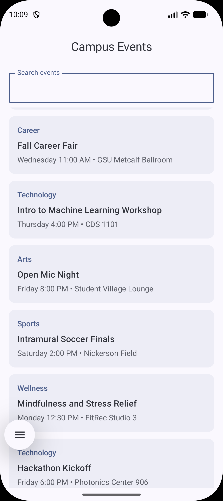
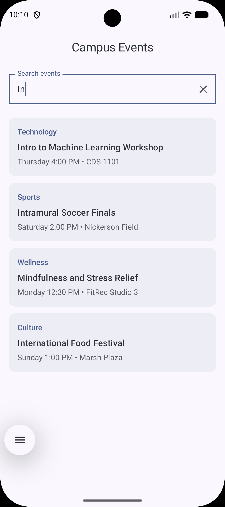
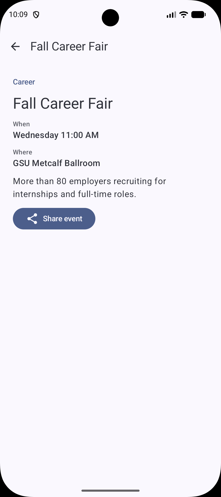

# Campus Event Explorer

## Screenshots

| Event list | Search results | Event detail |
|---|---|---|
|  |  |  |

## Questions

**1. Why does the route contain an event ID instead of the complete event object?**

The ID is small and never changes, so it's easy to save in the back stack. The detail screen uses the ID to look up the current event in `EventRepository`. Passing the whole object would make a copy that could become out of date. If no event matches the ID, the screen shows "Event unavailable" instead of crashing.

**2. Which composable owns the search state?**

The `composable<EventList>` destination inside `CampusEventNavHost` owns it. `EventListScreen` doesn't store anything: it receives `query` and reports changes through `onQueryChange`. The filtered list is calculated from `query` each time, not kept as a separate list.

**3. Why does the search value use `rememberSaveable`?**

Rotating the device recreates the Activity, and plain `remember` would lose the text. `rememberSaveable` saves it, so the search text survives rotation and is still there after returning from the detail screen.

**4. What happens to the back stack when an event is selected?**

`navigate(EventDetail(id))` pushes a new entry on top, so the back stack becomes `[EventList, EventDetail]`. Pressing Back or the Up button pops it, which returns to the list.

**5. How does the UI request navigation without directly accessing the NavController?**

The screens only take callbacks such as `onEventSelected`, `onBack`, and `onShare`. The `NavHost` passes in these callbacks, and it is the only place that calls `navController`.

**6. What makes the Share action an implicit intent?**

The intent only gives an action (`ACTION_SEND`) and a data type (`text/plain`) and doesn't name a specific app. Android finds every app that can handle it, and `Intent.createChooser()` lets the user pick one.

## AI Disclosure

I used Claude as a learning aid while building this project. I used it to:

- Generate the sample event data (titles, locations, times, and descriptions).
- Explain concepts I was unsure about, such as type-safe navigation routes, why `LazyColumn` needs stable keys, and implicit intents.
- Explain what `@OptIn(ExperimentalMaterial3Api::class)` does and why it's needed.
- Help with setup questions, such as adding the Navigation and Serialization dependencies.
- Suggest formatting and UI polish.
- Draft this README, which I reviewed and edited.
